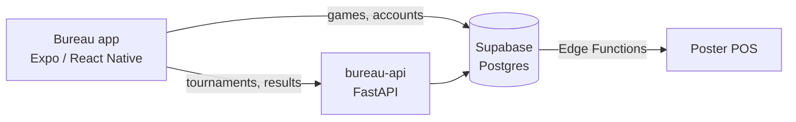

# bureau-api

[](https://github.com/anton-yarmilko/bureau-api/actions/workflows/ci.yml)

Tournaments and Elo ratings for **Bureau**, a bar in Vinnytsia whose guests play chess,
checkers, backgammon and darts through the bar's mobile app (Expo / React Native + Supabase).

The app already handles games, accounts and Poster POS sync. This service adds the part that
needs real backend logic: knockout and round-robin brackets, results, and per-game ratings.

## What it does

- **Players** — guests, optionally linked to their Supabase account (`user_id`)
- **Tournaments** — single elimination (with byes and standard seeding) or round robin
- **Seeding by rating** — strongest players are kept apart until the final
- **Results** — winners advance automatically; ratings update after every game
- **Elo ratings** per game — faster K-factor for the first 30 games, then it settles
- **Leaderboard** per game



## API

| Method | Path | What |
| --- | --- | --- |
| GET | `/health` | liveness |
| POST | `/players` | create a player |
| GET | `/players/{id}` | one player |
| GET | `/leaderboard?game=chess` | top ratings for a game |
| POST | `/tournaments` | create (draft) |
| POST | `/tournaments/{id}/entries` | enter a player |
| POST | `/tournaments/{id}/start` | seed, build the bracket, resolve byes |
| GET | `/tournaments/{id}` | bracket with all matches |
| POST | `/matches/{id}/result` | `{"winner_id": ...}` or `{"draw": true}` (round robin only) |

Write endpoints require an `X-API-Key` header. If `API_KEY` is not configured, writes are refused
(fail closed) rather than left open.
Interactive docs: `http://localhost:8000/docs`.

## Run it

```bash
# Postgres + API in Docker
API_KEY=$(openssl rand -hex 16) docker compose up --build

# or locally with SQLite
uv sync
uv run alembic upgrade head
API_KEY=dev uv run uvicorn app.main:app --reload
```

## Tests

```bash
uv run pytest        # rating math, bracket generation, full API flows (SQLite)
TEST_DATABASE_URL=postgresql+psycopg://... uv run pytest   # same suite on Postgres
uv run ruff check .
```

CI runs lint, the test suite on both SQLite and Postgres, migration checks and a Docker build
on every push.

## Design notes

- `app/rating.py` and `app/brackets.py` are pure functions with no database, so the tricky
  logic is tested directly and fast.
- `app/services.py` holds the workflow and the rules (e.g. knockout matches cannot be drawn,
  a result can be recorded once).
- Results, entries and bracket starts lock the tournament row (`SELECT ... FOR UPDATE`), and
  rating rows are locked in a fixed order, so simultaneous submissions apply exactly once
  without deadlocks. A Postgres-only test fires four results at one match at the same time.
- A round robin with a shared first place finishes without a single winner instead of
  quietly picking one.
- Schema changes go through Alembic migrations; the same models run on SQLite in tests and
  Postgres in production.

## Stack

Python 3.12 · FastAPI · Pydantic · SQLAlchemy 2 · Alembic · PostgreSQL · pytest · Ruff · uv ·
Docker · GitHub Actions

Built by [Anton Yarmilko](https://www.linkedin.com/in/anton-yarmilko) with AI-assisted
development; every file reviewed by hand.

## License

MIT
